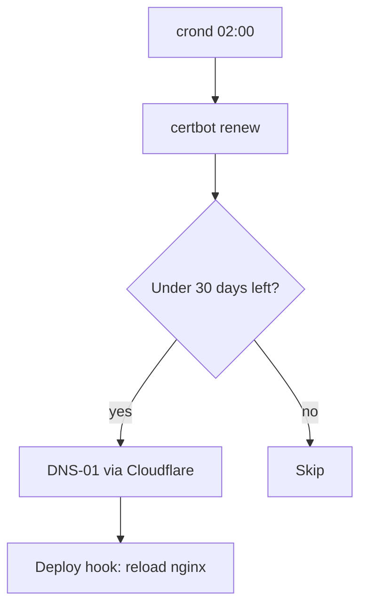

# Before you start

You need shell access to the proxy host and a Cloudflare token with **Zone, DNS, Edit**.

# Check the current state

```
certbot certificates
head -1 /etc/periodic/daily/certbot-renew
```

::: note
The first line of the renewal script must be `#!/bin/sh`. A typo here stops nightly renewal silently.
:::

# Renew

1. Run the forced renewal.
2. Test the nginx configuration.
3. Reload nginx.

```bash
certbot renew --force-renewal
nginx -t && rc-service nginx reload
```

## If it fails

| Symptom | Likely cause | Fix |
|---|---|---|
| Connection reset by peer | Staging server blocked on this host | Ignore for dry runs; test on production |
| 403 from Cloudflare | Token lacks DNS edit | Re-issue the token |

# How renewal works



# Verify

- [ ] `certbot certificates` shows 60+ days remaining
- [ ] Browser shows the new expiry date
